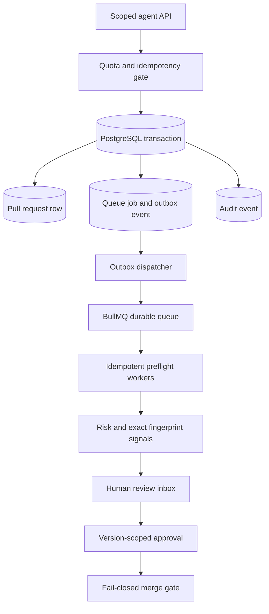

# DevHub

**AI-native contribution infrastructure, designed for bursty agent-generated pull requests and human-controlled decisions.**

DevHub is **not a GitHub wrapper**. Its intended product is a native Git host with identity-aware agent APIs, a durable event system, explicit review gates and serialized merge coordination. The present repository contains **milestone 1**, a functional PR-metadata ingestion and review-control prototype. It does **not yet serve Git smart HTTP**, execute external tests, perform semantic review, or merge real Git refs.

## Current implementation

- Next.js 16 application with a professional light UI and a password-protected contribution inbox populated from real PostgreSQL records. Includes full-text table filtering, risk/status tabs, sort controls, repository and agent directories, and read-only merge queue.
- PostgreSQL + Prisma data model for repositories, agents, credentials, PRs, reviews, checks, fingerprints, merge groups, approvals, jobs, outbox and audit trail.
- Scoped agent credentials (SHA-256 hashes at rest), revocation and expiration fields, and a scoped PR ingestion endpoint.
- Atomic PR creation + queue record + outbox event + audit record within **one database transaction**.
- Polling outbox dispatcher using PostgreSQL `FOR UPDATE SKIP LOCKED` and stable BullMQ job IDs.
- Workers with SQL job claiming, expiring leases, retries, duplicate fingerprint signals and rule-based risk classification.
- Repository/agent per-minute ingress quotas, repository active-PR quota, HTTP `429` backpressure and content-bound idempotency keys.
- Human approval recording with version binding; all real merge operations currently fail closed.
- Script for synthetic 1,000-PR ingestion and tests for security-sensitive policy primitives.

The preflight check validates **submitted metadata**, not source-code authenticity, compilation or test execution. Duplicate fingerprints are advisory; no changes are silently discarded. Submitted SHA/patch values are not verified against Git objects in this milestone.

## Local setup

**Requires:** Node.js 22.18+ (24 recommended), Docker Compose, npm.

```bash
cp .env.example .env
# Replace APP_SECRET, ADMIN_TOKEN, BOOTSTRAP_AGENT_TOKEN with distinct random secrets.
# Example secret generation: openssl rand -hex 32

docker compose up -d
npm install
npm run db:generate
npm run db:migrate
npm run db:seed
```

Open three terminal windows:

```bash
npm run dev
npm run dispatcher
npm run worker
```

Visit <http://localhost:3000/login> and use your `ADMIN_TOKEN`. All infrastructure ports are bound to localhost in Compose; the app is not production hardened and should not be exposed publicly.

### Submit a contribution

```bash
curl -i http://localhost:3000/api/v1/pull-requests \
  -H "Authorization: Bearer $BOOTSTRAP_AGENT_TOKEN" \
  -H 'Content-Type: application/json' \
  -H 'Idempotency-Key: first-change-v1' \
  --data '{
    "repository": "sarollahi/DevHub",
    "title": "Improve developer documentation",
    "description": "Example contribution to test ingestion",
    "sourceBranch": "agents/improve-docs",
    "sourceSha": "2222222222222222222222222222222222222222",
    "targetBranch": "main",
    "targetSha": "1111111111111111111111111111111111111111",
    "changedFiles": ["docs/guide.md"],
    "patch": "diff --git a/docs/guide.md b/docs/guide.md\n+New documentation"
  }'
```

A successful new submission returns **HTTP 202** and its PR ID. Retries with the same idempotency key and identical content return **HTTP 200**. Reusing a key with changed content returns **HTTP 409**. Rates or capacity exceeded return **HTTP 429** with `Retry-After`. Status/approval APIs require administrator credentials.

## Synthetic ingestion test

The default per-agent ingress limit is 120 PRs/min. To test approximately 1,000 accepted submissions in a burst, create ten separate machine identities and run:

```bash
SEED_AGENT_COUNT=10 npm run db:seed
SEED_AGENT_COUNT=10 BURST_COUNT=1000 BURST_CONCURRENCY=20 npm run stress:ingest
```

The script uses **synthetic commits and patches** to isolate API admission and queue performance. It prints accepted, rate-limited and failed requests and elapsed time. Any contention/error means that run did not achieve its intended acceptance. To assess true processing capacity, wait for queue drain and inspect actual database/check counts; do not treat ingestion numbers as merge, CI or Git-hosting performance. If submitting through one agent, the rate limiter intentionally rejects excess requests.

## Architecture



**Failure model:** A committed PR cannot lose its work intent because the job and outbox row commit together. If Redis is unavailable, outbox events remain pending and are retried. If publication succeeds but the publisher crashes before acknowledgement, it will retry with the same Redis job ID and the worker's durable SQL state prevents duplicate effects. The system targets *at-least-once delivery with idempotent effects*, not magical exactly-once external execution. Jobs must not be removed from Redis before outbox replay is safe; persisted job states are authoritative for processing side effects.

### State model

`QUEUED → RUNNING → REVIEW_REQUIRED → APPROVED`; blocked/failed/closed/merged states are reserved. `MERGED` is intentionally unreachable in the current build, because Git state is not yet authoritative. `APPROVED` records only a human decision and never overrides required checks. The dashboard shows genuine data or an empty state, never fabricated workload totals. The visual sample screenshot is illustrative and is not embedded in the application.

### Security boundaries

- Agent tokens are high-entropy bearer secrets, stored only as hashes. `pull_requests:write` is the initial permission scope. Store credentials in a secrets manager and rotate/revoke as needed.
- All ingested patch text is **untrusted input**. It is displayed as text, not executed as code or CI commands.
- The metadata risk score is advisory and cannot grant merge permission. Security-sensitive paths and suspicious text are flagged for manual review.
- Never run untrusted CI scripts on app or database hosts. Future CI runners require isolated, ephemeral sandboxes and egress controls.
- The admin session uses an HTTP-only, strict same-site cookie. It is a development-only single-owner login, not production multi-user RBAC.
- No automated approval is allowed to satisfy a human-approval requirement.
- `POST /api/v1/pull-requests/:id/merge` returns HTTP 501 until an authoritative Git ref, required-check verifier, protected-branch policy evaluator and compare-and-swap merge coordinator exist.

## Next milestones, in dependency order

1. **Native Git host:** bare Git object storage, Git smart HTTP clone/fetch/push with authorization, SHA/patch verification, protected refs and isolated storage per repository.
2. **Real PR lifecycle:** validated branch comparisons, revision updates, immutable head/base versions, reviewer assignments, concurrency-safe invalidation of approvals/checks on new commits.
3. **Sandboxed CI:** executable tests, lint, SAST, dependency vulnerability scans, secrets scans, signed evidence and check reporting bound to exact commit SHAs.
4. **Review intelligence:** changed-file overlap, semantically related proposals, issue grouping, model-backed summaries and independent findings with recorded model/cost; no silent auto-rejection.
5. **Merge coordinator:** per-target-branch serialization, current-ref revalidation, policy/required-check enforcement, merge groups with combined-tree CI, atomic ref update and audit trail.
6. **Scale and operations:** fair tenant scheduling, cancellation, dead-letter inspection, expiring queue-job reconciliation, backpressure metrics, tracing, load profiles and cost quotas.

This order is deliberate. Connecting a fake merge button before real Git integrity and execution isolation would make the product unsafe. The current architecture keeps those responsibilities explicit instead of pretending they are complete.

## Authors

**sarollahi** · ahmad.sarollahi@gmail.com

## Product interface

The interface is deliberately designed as a professional developer tool rather than a dark-themed assistant screen:

- Neutral white and warm-gray surfaces, clear hierarchy, and compact status chips.
- Searchable contribution table with working state and risk filters and sorting.
- Risk information stays visibly provisional until verified from Git objects.
- Repository and machine-identity directories are backed by persisted records.
- Merge queue is explicitly read-only until verified Git integration is delivered.
- Responsive layouts, accessible labels, and keyboard-visible focus rings.

## Unfinished before production

Native Git smart HTTP, trusted commit-derived diffs, CI runner isolation, trusted check provenance, semantic similarity, merge coordination, multi-user authentication, full authorization policy, observability, and formal scalability benchmarks remain planned. Do not make this service publicly reachable before these security boundaries are implemented.

The initial SQL migration is committed under `prisma/migrations/`. Verify it against the Prisma schema with `prisma migrate dev` during first local setup. Generate and commit an npm dependency lockfile during first online setup, before production deployments.
